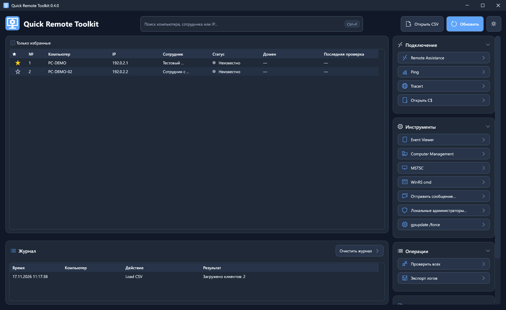
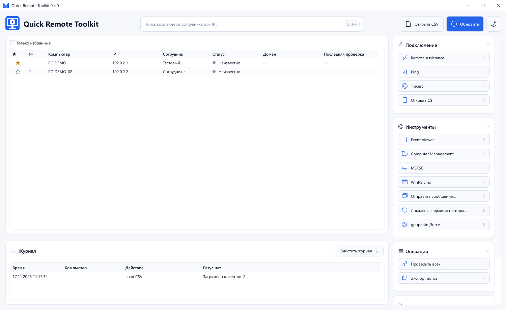

# Quick Remote Toolkit

Windows-приложение для быстрых действий удалённой поддержки. Единственная
поддерживаемая реализация — Rust + egui/eframe; текущая версия **0.4.1**.



## Скачать и запустить

Скачайте `QuickRemoteToolkit.Rust-win-x64.zip` из [Releases](https://github.com/bdpst/Quick-Remote-Toolkit-App/releases/latest),
распакуйте в отдельную папку и запустите `QuickRemoteToolkitRust.exe`.
Рядом находятся `RUNTIME.txt` и `BUILD-INFO.json` с версией и исходным коммитом.
Контрольная сумма ZIP опубликована в `SHA256SUMS`.

Нужны **Windows 10/11 x64** и видеодрайвер с поддержкой OpenGL 3.3.
.NET Desktop Runtime, Rust и инструменты разработки для запуска не нужны.
Используются штатные Windows DLL, Windows PowerShell, сетевые средства и службы
для соответствующих удалённых операций. Интерфейс запускается без запроса повышения
прав; полномочия определяются текущей Windows-сессией.

## Возможности

- Загрузка списка клиентов, поиск по компьютеру, IP и сотруднику; Ctrl+F.
- Избранные ПК, фильтр избранного, сортировка, перестановка и ширина колонок,
  копирование полей, контекстные меню.
- Проверка доступности одного или всех ПК параллельными ICMP-запросами.
- Remote Assistance, ping, tracert, административная шара C$, Event Viewer,
  Computer Management, MSTSC, WinRS cmd и gpupdate.
- Сообщение сеансам пользователей через Windows WTS API с ожиданием ОК/Отмена/тайм-аута.
- Добавление/удаление членства в локальных администраторах через PowerShell Remoting.
- Светлая/тёмная темы, изменяемая высота журнала, экспорт TXT/CSV и очистка журнала.



## CSV и настройки

```csv
number;computer;ip;person
1;PC-DEMO;192.0.2.1;Тестовый сотрудник
```

Первая строка — заголовок; разделитель `;`, кодировка UTF-8 (допустим BOM) или
Windows-1251. Используйте [обезличенный пример](samples/clients.example.csv).
Поля не должны содержать `;` и переводы строк: импорт не является полным RFC CSV-парсером.
Выберите файл через «Открыть CSV»; «Обновить» перечитывает его.

Настройки: `%AppData%\QuickRemoteToolkitApp\settings.json`. Сохраняются путь CSV,
тема, избранное/фильтр, PingTimeoutMs и ParallelPingLimit; неизвестные поля JSON
сохраняются. Эффективный параллелизм ограничен 1–128. Перед первой перезаписью
существующего файла создаётся `settings.before-rust.json`. Повреждённый JSON
не заменяется пустыми настройками. Журнал действий хранится **в памяти до закрытия**,
автоматического файла журнала нет. Сохраните его через «Экспорт» в UTF-8 TXT либо CSV;
место выбирается в диалоге. Текст отправленных сообщений не сохраняется в журнале.

### Переход с 0.3.x

Распакуйте актуальную поставку и запустите новый EXE. Старые CSV, settings.json и избранное
используются без конвертации. Сохранённые данные остаются в прежнем AppData-каталоге.
Не запускайте несколько версий одновременно для изменения одних настроек.
Устаревший `settings-rust.json` раннего прототипа не импортируется вместо settings.json.
Старая C#/WPF-реализация больше не поддерживается; её исходники доступны в истории Git.

## Сеть и права Windows

Пароли не запрашиваются и не хранятся. Все операции выполняются от текущего пользователя.

| Действие | Требования |
| --- | --- |
| C$ | SMB, доступ к административной шаре и права локального администратора. Подготовка IPC$ использует текущую Windows-учётную запись. |
| WinRS/gpupdate и локальные администраторы | Рабочий WinRM, разрешённый PowerShell Remoting и подходящие права. Для членства нужен Microsoft.PowerShell.LocalAccounts на целевой Windows. |
| Сообщения WTS | Доступ к сеансам и права отправки сообщений на целевом ПК; сетевые правила Windows должны допускать WTS. |
| RDP/Remote Assistance/MMC | Доступность штатного инструмента, разрешённая служба и необходимые права на целевом ПК. |
| Проверка доступности | ICMP должен проходить через брандмауэр; отсутствие ответа не доказывает выключение ПК. |

Если `dir \\PC-DEMO\c$` или `winrs -r:PC-DEMO hostname` не работают вручную,
сначала проверьте сеть, службы и права. ОК в сообщении WTS не доказывает прочтение.
Изменение администраторов затрагивает только членство, не удаляет учётную запись.
После тайм-аута административной операции результат может быть неизвестен:
проверьте состояние на целевом ПК перед повтором. Запуск внешнего инструмента
фиксируется отдельно от результата удалённого действия.

## Сборка и проверки

Нужны Windows x64, **Rust 1.99.1**, MSVC Build Tools с Windows SDK (`rc.exe`) и PowerShell 7.
Для PE/ZIP-проверки нужен Python 3.10+. Из корня checkout:

```powershell
rustup toolchain install 1.99.1 --profile minimal --component rustfmt --component clippy
rustup default 1.99.1
cargo fmt --check --manifest-path src/QuickRemoteToolkit.Rust/Cargo.toml
cargo clippy --locked --manifest-path src/QuickRemoteToolkit.Rust/Cargo.toml --all-targets -- -D warnings
cargo test --locked --manifest-path src/QuickRemoteToolkit.Rust/Cargo.toml
cargo build --release --locked --manifest-path src/QuickRemoteToolkit.Rust/Cargo.toml
./src/QuickRemoteToolkit.Rust/build.ps1 -OutputDirectory ./publish-rust
python ./src/QuickRemoteToolkit.Rust/tests/verify-artifact.py ./publish-rust/QuickRemoteToolkitRust.exe ./publish-rust/QuickRemoteToolkit.Rust-win-x64.zip ./publish-rust/validation.json
./src/QuickRemoteToolkit.Rust/tests/portable-smoke.ps1 -Archive ./publish-rust/QuickRemoteToolkit.Rust-win-x64.zip -OutputDirectory ./publish-rust/smoke
```

build.ps1 статически линкует CRT, встраивает иконки, Windows-версию и PerMonitorV2/asInvoker
manifest, создаёт ZIP с фиксированными timestamps. При нестандартной установке SDK
задайте `QRT_RC` полным путём к `rc.exe`. Build output не коммитится.

QA интерфейса в отдельном Rust-host (не входит в поставку):

```powershell
./src/QuickRemoteToolkit.Rust/tests/ui-smoke.ps1 -OutputDirectory ./publish-rust/ui-qa
```

Host использует отдельный AppData, обезличенный CSV и настоящий framebuffer,
проверяет обе темы/диалоги без административных действий. Это не заменяет физическую
проверку всех DPI/мониторов. Реальные SMB/WinRM/WTS на тестовых ПК и отдельная чистая
Windows-машина без средств разработки не проверялись при подготовке 0.4.0.

## Разработка и релизы

Правила: [AGENTS.md](AGENTS.md), [конституция](.specify/memory/constitution.md),
[дизайн](docs/design-guidelines.md). Для существенных функций установлен Spec Kit:
`$speckit-specify` → `$speckit-plan` → `$speckit-tasks` → `$speckit-implement`.
Завершение миграции: [006](specs/006-rust-release/spec.md); старые specs — история.

Версия задаётся в Cargo.toml и соответствующей записи Cargo.lock. UI, Windows metadata
и упаковка получают её автоматически. Обновите CHANGELOG и файл release notes,
пройдите локальные проверки, PR/правила репозитория и успешный CI итогового main.
Только затем поставьте тег на проверенный коммит:

```powershell
git tag -a v0.4.1 <verified-main-sha> -m "Release 0.4.1"
git push origin v0.4.1
```

Workflow поддерживает теги `0.4.0` и `v*`, проверяет совпадение версии и публикует
стабильный GitHub Release с ZIP, SHA256SUMS и BUILD-INFO.json. Дождитесь результата,
скачайте и проверьте артефакты/коммит. Не перезаписывайте опубликованные теги/релизы.
Изменения версии: [CHANGELOG](CHANGELOG.md).
